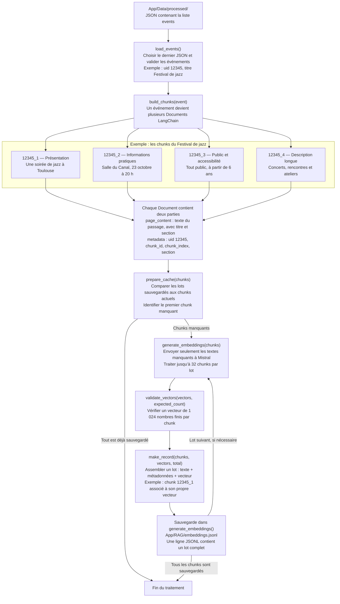

# Comprendre `build_embeddings.py`

Ce script transforme les événements OpenAgenda prétraités en passages de texte (**chunks**), puis en représentations numériques (**embeddings**). Il sauvegarde progressivement le texte, les métadonnées et le vecteur de chaque chunk dans un fichier JSONL.

## Le parcours des données

`main()` coordonne le traitement. L’exemple suit **Festival de jazz**, UID **12345**.

Les contenus des blocs sont abrégés pour la lecture. La description longue reste entière si elle tient dans la place disponible ; sinon, elle est divisée par caractères avec un chevauchement de 150 caractères. La référence de 2 048 caractères inclut l’en-tête ; les trois autres sections restent entières.

## Ce qu’il faut retenir

- **Un événement donne plusieurs chunks.** Chaque chunk possède son texte et son identifiant, par exemple `12345_1`. Les fragments de description portent aussi leur numéro de partie et les liens vers leurs voisins.
- **Seul `page_content` est envoyé à Mistral.** Les métadonnées servent à identifier le chunk ; les informations complètes de l’événement restent dans le JSON prétraité.
- **Une ligne JSONL représente un lot, pas un seul chunk.** Elle contient jusqu’à 32 associations entre texte, métadonnées et vecteur. Le dernier lot peut être plus court.
- **La reprise évite les recalculs.** `prepare_cache()` valide le nombre, l’ordre, les textes, les métadonnées et les vecteurs des chunks sauvegardés, puis renvoie leur nombre.
- **Une interruption ne fait pas perdre les lots complets.** Seule une dernière ligne reconnue comme incomplète est supprimée. Les autres incohérences provoquent une erreur sans modifier le cache. Chaque sauvegarde utilise `flush()` puis `os.fsync()`.
