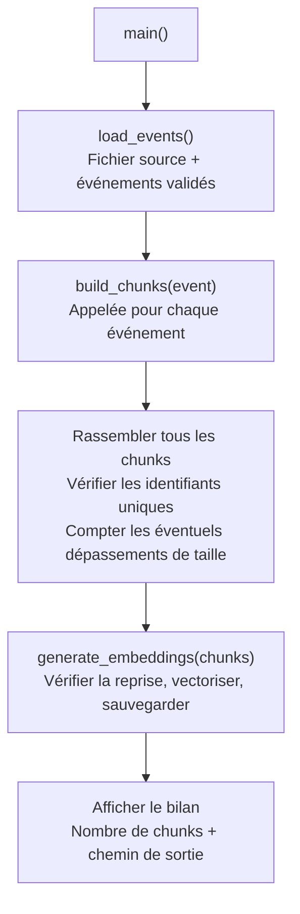
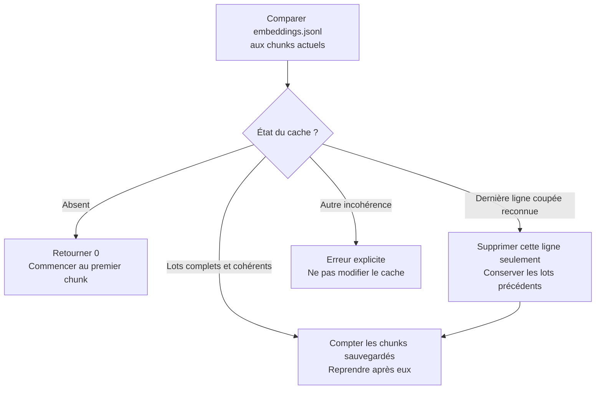

# Comprendre `build_embeddings.py` sans lire tout le code

**Mission :** préparer une représentation numérique des événements OpenAgenda, en conservant pour chaque passage son texte, son identification et son vecteur.

<table>
<tr><th>ENTRÉE</th><th>TRANSFORMATION</th><th>SORTIE</th></tr>
<tr><td>JSON prétraité <code>App/Data/processed/</code></td><td>Événements → chunks thématiques → embeddings</td><td><code>App/Data/embeddings/embeddings.jsonl</code> Texte + métadonnées + vecteur</td></tr>
</table>

**Fil conducteur :** l’événement fictif **Festival de jazz**, UID **12345**. Les contenus sont abrégés. Dans l’exemple, les trois premières sections tiennent chacune dans un chunk et la description longue nécessite deux fragments. D’autres événements peuvent produire davantage de fragments dans n’importe quelle section.

Les chemins sont calculés depuis le fichier [build_embeddings.py](../build_embeddings.py), indépendamment du dossier de lancement. Les données prétraitées sont uniquement lues ; le résultat est enregistré sous `App/Data/embeddings/`.

## 1. Qui pilote le script ?

<table>
<tr><th>Fichier lancé directement</th><th>Fichier importé par un autre programme</th></tr>
<tr><td><code>if __name__ == "__main__"</code> ↓ Appel de <code>main()</code> ↓ Traitement des événements</td><td>Les fonctions sont disponibles. <code>main()</code> n’est pas appelée automatiquement.</td></tr>
</table>

`main()` est le chef d’orchestre : elle coordonne les fonctions, sans réaliser elle-même la vectorisation.

<table>
<tr><th>Entrée de <code>main()</code></th><th>Sortie et erreurs</th></tr>
<tr><td>Aucun argument. Elle utilise les chemins et constantes du fichier.</td><td>Pas de valeur retournée : le résultat est écrit sur disque. Au lancement, les erreurs de fichiers ou de données sont affichées avec un code de sortie non nul. Les autres exceptions gardent leur trace détaillée.</td></tr>
</table>

## 2. Charger les événements — `load_events()`

<table>
<tr><th>CE QUI ENTRE</th><th>CE QUE LA FONCTION FAIT</th><th>CE QUI SORT</th></tr>
<tr><td><code>openagenda_processed_*.json</code> Un objet JSON contenant <code>events</code></td><td>Choisit le fichier le plus récemment modifié. Lit le JSON en UTF-8. Valide la liste et les événements.</td><td>Un couple : <code>(source, events)</code> Chemin du fichier + liste de dictionnaires Python</td></tr>
</table>

<table>
<tr><td><strong>Extrait de notre événement</strong><pre>uid : 12345
title : "Festival de jazz"
description : "Concert à Toulouse"
date_range : "10 novembre"
public : ["Tout public"]
long_description : "Programme détaillé des concerts…"</pre></td><td><strong>Contrôles avant tout appel payant</strong> ✓ Liste <code>events</code> non vide ✓ Chaque événement est un dictionnaire ✓ UID entier ou texte, non vide et unique ✓ Un booléen n’est pas un UID valide ✓ Titre textuel non vide ✓ Description longue textuelle, nulle ou absente</td></tr>
</table>

**Pourquoi cette étape ?** Arrêter les données incompatibles avant de construire les chunks. Le prétraitement n’est pas refait et la source n’est pas modifiée.

## 3. Découper un événement — `build_chunks(event)`

<table>
<tr><th>ENTRÉE</th><th>TRAITEMENT</th><th>SORTIE</th></tr>
<tr><td>Un dictionnaire : Festival de jazz, UID 12345</td><td>Regrouper les champs par thème. Découper chaque section seulement si nécessaire. Ajouter l’en-tête, les identifiants et les liens.</td><td>Une liste de <code>Document</code> LangChain Chaque <code>page_content</code> ≤ 2 048 caractères</td></tr>
</table>

<table>
<tr><th colspan="2">UN ÉVÉNEMENT → PLUSIEURS CHUNKS DISTINCTS</th></tr>
<tr><td><strong>12345_1 — Présentation</strong> Festival de jazz Concert à Toulouse</td><td><strong>12345_2 — Informations pratiques</strong> UID : 12345 Date : 10 novembre</td></tr>
<tr><td><strong>12345_3 — Public et accessibilité</strong> Tout public</td><td><strong>12345_4 — Description longue, partie 1/2</strong> Début du programme… <code>next_chunk_id : 12345_5</code></td></tr>
<tr><td><strong>12345_5 — Description longue, partie 2/2</strong> …suite du programme <code>previous_chunk_id : 12345_4</code></td><td><strong>Intérêt du regroupement</strong> Chaque passage porte un thème identifiable et garde le titre de l’événement pour conserver son contexte.</td></tr>
</table>

<table>
<tr><th>RÈGLE</th><th>CONSÉQUENCE</th></tr>
<tr><td>Trois premières sections</td><td>Toujours créées. Chacune reste entière si son texte et son en-tête tiennent dans 2 048 caractères ; sinon, elle est découpée.</td></tr>
<tr><td>Description longue vide, nulle ou absente</td><td>Aucun chunk de description ; les trois autres sections restent présentes.</td></tr>
<tr><td>N’importe quelle section qui tient dans l’espace disponible</td><td>Un seul chunk, sans découpage. L’en-tête contient le titre de l’événement et le nom du thème.</td></tr>
<tr><td>N’importe quelle section trop longue</td><td><code>RecursiveCharacterTextSplitter</code> essaie les paragraphes, les lignes, les espaces, puis les caractères. La taille disponible réserve la place du titre, du thème et de la numérotation.</td></tr>
<tr><td>Chevauchement visé de 150 caractères</td><td>Conserver du contexte entre fragments. Le chevauchement réel peut être inférieur selon les séparateurs naturels ; il ne concerne pas deux thèmes différents.</td></tr>
<tr><td>Champ supplémentaire dans l’événement</td><td>Ajout aux informations pratiques, sauf <code>long_description</code> et <code>timings</code>.</td></tr>
</table>

**Attention :** 2 048 caractères ne signifie pas 2 048 tokens. `build_chunks()` vérifie la taille finale de chaque `page_content`, en-tête compris, et refuse tout dépassement. Un en-tête laissant au plus 150 caractères pour le découpage ou une section dépassant 99 999 fragments provoque également une erreur. Le compteur supplémentaire dans `main()` ne remplace pas ce contrôle bloquant.

Les séparateurs sont conservés et `strip_whitespace=False` évite de retirer les espaces aux bords des fragments. Les champs des trois premières sections sont présentés sous la forme `champ : valeur`, avec des valeurs sérialisées en JSON ; la description longue est utilisée comme texte directement. Le découpage ne constitue pas un nouveau nettoyage des données.

## 4. Comprendre l’objet transporté : un `Document`

La création de ces objets se fait dans `build_chunks()` : il n’existe pas de fonction supplémentaire dédiée.

<table>
<tr><th><code>page_content</code> — LE TEXTE</th><th><code>metadata</code> — L’IDENTIFICATION</th></tr>
<tr><td><pre>Événement : Festival de jazz
Section : Présentation
title : "Festival de jazz"
description : "Concert à Toulouse"</pre></td><td><pre>uid : 12345
chunk_id : "12345_1"
chunk_index : 1
section : "Présentation"</pre></td></tr>
<tr><td>Envoyé à Mistral pour produire le vecteur. Le texte et ses libellés donnent du contexte au modèle.</td><td>Sauvegardé avec le texte, mais pas envoyé au modèle. L’UID rattache le passage à l’événement source.</td></tr>
</table>

<table>
<tr><th>POUR TOUTE SECTION FRAGMENTÉE, EN PLUS</th><th>EXEMPLE DU CHUNK <code>12345_4</code></th></tr>
<tr><td>Numéro et nombre de parties</td><td><code>part : 1</code> · <code>total_parts : 2</code></td></tr>
<tr><td>Liens entre fragments</td><td><code>previous_chunk_id : null</code> · <code>next_chunk_id : "12345_5"</code></td></tr>
</table>

Les horaires complets et les autres informations de l’événement restent dans la source prétraitée. `timings` n’est recopié ni dans le texte vectorisé ni dans les métadonnées minimales.

`chunk_index` progresse sur l’ensemble de l’événement, même quand plusieurs thèmes sont découpés : `12345_1`, `12345_2`, etc. En revanche, `part` et `total_parts` numérotent les fragments d’une même section. Les liens `previous_chunk_id` et `next_chunk_id` restent dans cette section ; ils valent `null` lorsqu’il n’existe pas de voisin. L’en-tête d’un fragment indique par exemple `Section : Description longue - partie 1/2`.

## 5. Reprendre avant de payer — `prepare_cache(chunks)`

**Entrée :** la liste actuelle des chunks. **Sortie :** leur nombre déjà sauvegardé et valide, utilisé comme position de reprise.

<table>
<tr><th>CE QUI EST COMPARÉ</th><th>POURQUOI</th></tr>
<tr><td>Format, modèle et nombre total attendu</td><td>Refuser un fichier incompatible ou une quantité de chunks différente.</td></tr>
<tr><td>Nombre et ordre des chunks du lot</td><td>Reprendre à la bonne position, sans sauter ni répéter un passage.</td></tr>
<tr><td>Texte et métadonnées des chunks sauvegardés</td><td>Éviter de réutiliser un vecteur avec un passage modifié.</td></tr>
<tr><td>Vecteurs enregistrés</td><td>Refuser les dimensions incorrectes et les nombres non finis.</td></tr>
</table>

<table>
<tr><th>AVANT L’ARRÊT</th><th>AU REDÉMARRAGE</th></tr>
<tr><td>Lot 1 : sauvegardé Lot 2 : sauvegardé Lot 3 : écriture interrompue</td><td>Lots 1 et 2 : validés et réutilisés Dernière ligne coupée : retirée Lot 3 : demandé à nouveau au modèle</td></tr>
</table>

`is_incomplete_json(text, error)` aide à reconnaître une fin de JSON coupée. Elle renvoie un booléen et ne modifie pas le fichier. `prepare_cache()` ne répare que les cas reconnus en dernière ligne sans saut de ligne ; un lot complet valide est conservé, même s’il faut lui ajouter son séparateur final.

## 6. Vectoriser les passages manquants — `generate_embeddings(chunks)`

<table>
<tr><th>ENTRÉE</th><th>TRAITEMENT</th><th>EFFET PRODUIT</th></tr>
<tr><td>Liste de tous les <code>Document</code></td><td>Appeler <code>prepare_cache()</code>. Si tout est présent : terminer. Sinon : traiter les chunks manquants par lots de 32 maximum.</td><td>Ajouter progressivement les nouveaux lots à <code>embeddings.jsonl</code>. Pas de valeur retournée.</td></tr>
</table>

<table>
<tr><th>CE QUI PART CHEZ MISTRAL</th><th>CE QUI REVIENT</th><th>CE QUI RESTE ASSOCIÉ LOCALEMENT</th></tr>
<tr><td>Le <code>page_content</code> de chaque chunk du lot</td><td>Un vecteur de 1 024 nombres pour chaque texte</td><td>Le texte original et ses métadonnées</td></tr>
<tr><td><code>12345_1</code> : texte de présentation ↓ <code>model.embed_documents(texts)</code></td><td>Représentation numérique du passage <code>[0.12, -0.03, …]</code> Valeurs fictives et abrégées</td><td><code>uid : 12345</code> <code>chunk_id : 12345_1</code> et les autres champs d’identification</td></tr>
</table>

**Concept clé :** un embedding représente des caractéristiques du sens du texte. Ses coordonnées ne sont pas des mots-clés lisibles. La génération est effectuée par `mistral-embed`, via l’adaptateur LangChain `MistralAIEmbeddings`.

Le lot de 32 est un compromis entre un appel par texte et une requête trop volumineuse. Il ne garantit pas le respect de toutes les limites de l’API. Tous les chunks restent en mémoire, mais les vecteurs sont traités lot par lot.

Si le cache contient déjà tous les chunks valides, la fonction termine avant de créer le client Mistral. Sinon, elle charge `.env` sans remplacer les variables d’environnement existantes et exige `MISTRAL_API_KEY`. Aucun appel n’est effectué pour les lots sauvegardés et validés. La sauvegarde utilise l’UTF-8, conserve les accents et refuse les nombres JSON non finis.

## 7. Contrôler, assembler, sauvegarder

<table>
<tr><th>FONCTION OU ACTION</th><th>ENTRÉE → TRAITEMENT → SORTIE</th></tr>
<tr><td><code>validate_vectors(vectors, expected_count)</code></td><td>Vecteurs + nombre de textes attendus → vérifier un vecteur de 1 024 nombres finis par texte → aucune valeur retournée si valide ; erreur sinon. Également utilisée pour les vecteurs relus sur disque.</td></tr>
<tr><td><code>make_record(chunks, vectors, total)</code></td><td>Documents + vecteurs déjà validés + nombre total de chunks → associer les éléments dans le même ordre → dictionnaire représentant un lot.</td></tr>
<tr><td>Écriture dans <code>generate_embeddings()</code></td><td>Dictionnaire → sérialisation JSON sur une ligne → ajout au fichier, puis <code>flush()</code> et <code>os.fsync()</code>.</td></tr>
</table>

<table>
<tr><th colspan="3">UNE LIGNE JSONL = UN LOT</th></tr>
<tr><td colspan="3"><code>format_version : 2</code> · <code>model : "mistral-embed"</code> · <code>total_chunks : 5</code></td></tr>
<tr><th>Texte</th><th>Métadonnées</th><th>Vecteur</th></tr>
<tr><td>Présentation du festival</td><td><code>12345_1</code>, UID 12345, section, index</td><td>Son vecteur de 1 024 nombres</td></tr>
<tr><td>Informations pratiques</td><td><code>12345_2</code>, UID 12345, section, index</td><td>Son vecteur de 1 024 nombres</td></tr>
<tr><td>Public et accessibilité</td><td><code>12345_3</code>, UID 12345, section, index</td><td>Son vecteur de 1 024 nombres</td></tr>
<tr><td>Description, partie 1/2</td><td><code>12345_4</code> et liens entre fragments</td><td>Son vecteur de 1 024 nombres</td></tr>
<tr><td>Description, partie 2/2</td><td><code>12345_5</code> et liens entre fragments</td><td>Son vecteur de 1 024 nombres</td></tr>
</table>

Dans cet exemple à cinq chunks, tout tient dans une ligne. Sur le traitement complet, une ligne contient jusqu’à 32 chunks, éventuellement issus d’événements différents. `total_chunks` désigne le total du traitement, pas la taille du lot. Les sauts de ligne de `page_content` sont échappés à l’intérieur du JSON.

## 8. Forces, limites et utilisation du résultat

<table>
<tr><th>CHOIX</th><th>AVANTAGE</th><th>POINT D’ATTENTION</th></tr>
<tr><td>Chunks thématiques</td><td>Passages centrés sur un sujet, avec le titre comme contexte et une limite vérifiée pour toutes les sections.</td><td>Un thème long produit plusieurs fragments ; davantage de chunks signifie davantage de textes à vectoriser.</td></tr>
<tr><td>Métadonnées minimales</td><td>Évite la répétition des informations complètes dans chaque chunk.</td><td>L’UID doit permettre de retrouver l’événement dans la source.</td></tr>
<tr><td>Sauvegarde par lot</td><td>Réutilise les embeddings déjà enregistrés après un arrêt.</td><td>Un lot reçu mais non sauvegardé doit être recalculé.</td></tr>
<tr><td>Comparaison directe au redémarrage</td><td>Refuse les chunks sauvegardés dont le texte ou les métadonnées ont changé.</td><td>Pas d’empreinte globale ; les chunks non encore sauvegardés ne sont pas comparés à une ancienne version.</td></tr>
<tr><td>Validation des vecteurs</td><td>Contrôle la structure avant sauvegarde.</td><td>Ne mesure pas la qualité sémantique des embeddings.</td></tr>
<tr><td>Écriture simple, sans verrou</td><td>Mécanisme de reprise facile à suivre.</td><td>Une seule exécution simultanée. Une clé API et l’accès réseau sont nécessaires pour générer les vecteurs manquants.</td></tr>
</table>

<table>
<tr><th>CE QUE LE FICHIER PRODUIT PERMET ENSUITE</th></tr>
<tr><td><strong><code>embeddings.jsonl</code></strong> ↓ Un traitement suivant peut relire les trois éléments de chaque chunk, sans demander à nouveau les embeddings des événements. ↓ <strong>Vecteur :</strong> comparer des représentations numériques. <strong>Texte :</strong> restituer le passage correspondant. <strong>UID :</strong> retrouver l’événement complet dans les données prétraitées.</td></tr>
</table>

Ce script prépare ces données. Il ne répond pas lui-même aux questions et ne réalise pas les traitements suivants.
