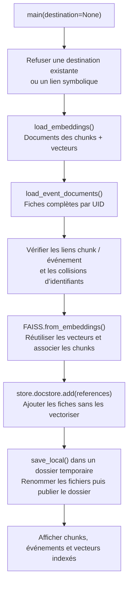
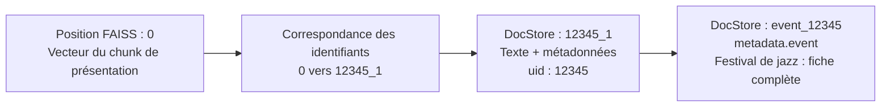
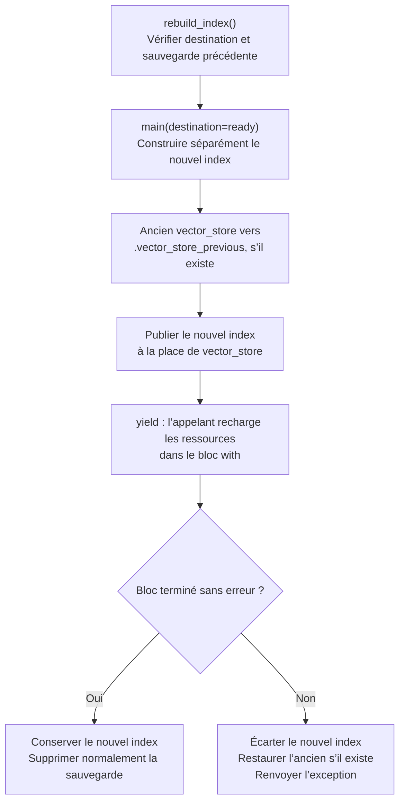

# Comprendre `build_index.py` sans lire tout le code

**Mission :** transformer les embeddings déjà sauvegardés en une base locale associant les vecteurs FAISS, les chunks et les fiches complètes des événements.

<table>
<tr><th>ENTRÉES</th><th>TRANSFORMATION</th><th>SORTIES</th></tr>
<tr><td><code>App/Data/embeddings/embeddings.jsonl</code> Dernier JSON de <code>App/Data/processed/</code></td><td>Valider les données Indexer les vecteurs existants Associer chunks et fiches complètes</td><td><code>App/Data/vector_store/Vector_Store.faiss</code> <code>App/Data/vector_store/DocStore_LangChain.pkl</code></td></tr>
</table>

**Fil conducteur :** l’événement fictif **Festival de jazz**, UID **12345**, possède cinq chunks créés précédemment : présentation, informations pratiques, public et deux fragments de description. Les exemples sont abrégés et les valeurs de vecteurs sont fictives.

Le fichier [build_index.py](../build_index.py) ne lit pas `.env`, ne génère pas de chunks et n’appelle aucune API. Il réutilise les résultats de [build_embeddings.py](../build_embeddings.py). Les chemins sont calculés depuis le fichier Python, indépendamment du dossier de lancement.

## 1. Qui pilote le script ?

<table>
<tr><th>EXÉCUTION DIRECTE</th><th>UTILISATION DEPUIS UN AUTRE FICHIER</th></tr>
<tr><td><code>if __name__ == "__main__"</code> ↓ <code>main()</code> ↓ Construction dans le dossier habituel</td><td>L’import ne déclenche aucune construction. <code>main(destination=...)</code> permet une autre destination. <code>rebuild_index()</code> coordonne le remplacement d’un index existant.</td></tr>
</table>

<table>
<tr><th>ENTRÉE DE <code>main()</code></th><th>RÉSULTAT ET ERREURS</th></tr>
<tr><td><code>destination</code> est facultative : un <code>Path</code> ou <code>None</code>. Sans argument : <code>App/Data/vector_store/</code>.</td><td>Pas de valeur retournée : les fichiers sont écrits sur disque. Au lancement direct, les erreurs de fichiers ou de données sont affichées avec un code de sortie non nul ; les autres exceptions conservent leur trace.</td></tr>
</table>

## 2. Retrouver les textes et vecteurs — `load_embeddings()`

<table>
<tr><th>CE QUI ENTRE</th><th>CE QUE LA FONCTION FAIT</th><th>CE QUI SORT</th></tr>
<tr><td><code>embeddings.jsonl</code> Une ligne = un lot de chunks</td><td>Lire chaque lot en UTF-8. Valider sa structure et ses éléments. Recréer les <code>Document</code> LangChain.</td><td><code>(documents, vectors)</code> Deux listes correspondantes : le document et son vecteur occupent le même indice.</td></tr>
</table>

<table>
<tr><th>EXTRAIT D’UN CHUNK ENREGISTRÉ</th><th>CONTRÔLES AVANT CONSTRUCTION</th></tr>
<tr><td><pre>page_content : "Événement : Festival de jazz…"
metadata :
  uid : 12345
  chunk_id : "12345_1"
  chunk_index : 1
  section : "Présentation"
vector : [0.12, -0.03, …]</pre>Le vecteur complet contient 1 024 valeurs.</td><td>✓ Format actuel : <code>format_version = 2</code> ✓ Modèle : <code>mistral-embed</code> ✓ Total attendu positif et identique dans tous les lots ✓ Lots de 32, sauf le dernier éventuellement plus court ✓ Texte non vide et métadonnées sous forme de dictionnaire ✓ <code>chunk_id</code> non vide et unique ✓ Vecteur de 1 024 nombres finis ✓ Total final égal au nombre de chunks annoncé</td></tr>
</table>

**Pourquoi cette étape ?** Un index partiel ou mal associé pourrait restituer un passage incorrect. Le script refuse une entrée vide, un lot incohérent ou un vecteur invalide. Il ne répare pas le JSONL : si une ligne est incomplète, le message demande de relancer `build_embeddings.py`, qui possède la logique de reprise.

## 3. Préparer les fiches complètes — `load_event_documents()`

<table>
<tr><th>ENTRÉE</th><th>TRAITEMENT</th><th>SORTIE</th></tr>
<tr><td>Dernier <code>openagenda_processed_*.json</code>, choisi selon sa date de modification puis son nom</td><td>Lire <code>events</code>. Vérifier une liste non vide et des UID exploitables. Refuser les doublons. Créer une fiche de référence par événement.</td><td>Un dictionnaire : <code>{"event_12345": Document(...), ...}</code></td></tr>
</table>

<table>
<tr><th>IDENTIFIANT DANS LE DOCSTORE</th><th><code>page_content</code></th><th><code>metadata</code></th></tr>
<tr><td><code>event_12345</code></td><td><code>Événement 12345</code> Un texte d’identification, pas la fiche complète sérialisée.</td><td><pre>uid : 12345
event :
  uid : 12345
  title : "Festival de jazz"
  timings : [...]
  age_min : 6
  …</pre>Le dictionnaire complet de l’événement est conservé.</td></tr>
</table>

Les listes, nombres et valeurs nulles restent dans leur structure d’origine. Les horaires détaillés `timings`, exclus du texte vectorisé lors du chunking, sont ainsi disponibles dans la fiche complète. **Cette fiche n’a pas de vecteur supplémentaire.**

## 4. Assembler FAISS, les chunks et les références — `main()`

Avant l’assemblage, `main()` extrait les `chunk_id`, vérifie qu’aucun n’entre en collision avec les identifiants `event_<uid>` et exige une fiche complète pour l’UID de chaque chunk.

<table>
<tr><th>APPEL</th><th>DONNÉES FOURNIES</th><th>EFFET</th></tr>
<tr><td><code>FAISS.from_embeddings()</code></td><td>Couples texte / vecteur Métadonnées des chunks Identifiants des chunks <code>ExistingEmbeddings()</code></td><td>Créer l’index numérique et le DocStore des chunks, avec la correspondance entre positions FAISS et identifiants.</td></tr>
<tr><td><code>store.index.ntotal</code></td><td>Index construit</td><td>Vérifier que le nombre de vecteurs est exactement égal au nombre de chunks.</td></tr>
<tr><td><code>store.docstore.add(references)</code></td><td>Documents <code>event_12345</code>, etc.</td><td>Ajouter les fiches complètes dans le DocStore sans modifier le nombre de vecteurs.</td></tr>
</table>

### À quoi sert `ExistingEmbeddings` ?

LangChain attend un objet respectant son interface `Embeddings`, même lorsque les vecteurs sont déjà fournis. Cette petite classe satisfait ce contrat ; ses méthodes `embed_documents()` et `embed_query()` lèvent une erreur si elles sont appelées. C’est un garde-fou contre une vectorisation accidentelle, pas un modèle d’embedding local.

`from_embeddings()` utilise les vecteurs reçus. Ajouter les références avec `docstore.add()` ne vectorise rien non plus ; utiliser `add_documents()` à cet endroit déclencherait au contraire une demande d’embeddings et serait bloqué par ce garde-fou.

### Un événement, cinq vecteurs et six documents

<table>
<tr><th>POSITION FAISS</th><th>ID DU DOCUMENT ASSOCIÉ</th><th>TYPE ET LIEN</th></tr>
<tr><td>0</td><td><code>12345_1</code></td><td>Chunk Présentation · UID 12345</td></tr>
<tr><td>1</td><td><code>12345_2</code></td><td>Chunk Informations pratiques · UID 12345</td></tr>
<tr><td>2</td><td><code>12345_3</code></td><td>Chunk Public et accessibilité · UID 12345</td></tr>
<tr><td>3</td><td><code>12345_4</code></td><td>Chunk Description longue 1/2 · UID 12345</td></tr>
<tr><td>4</td><td><code>12345_5</code></td><td>Chunk Description longue 2/2 · UID 12345</td></tr>
<tr><td>Aucune</td><td><code>event_12345</code></td><td>Fiche complète, présente uniquement dans le DocStore</td></tr>
</table>

Les positions présentées supposent que le fichier ne contient que cet événement, dans cet ordre. Sur le traitement complet, les positions continuent avec les chunks des autres événements. **Le nombre de documents du DocStore peut donc dépasser le nombre de vecteurs FAISS.**

## 5. Comprendre les deux fichiers produits

<table>
<tr><th>FICHIER</th><th>CE QU’IL CONSERVE</th><th>UTILITÉ</th></tr>
<tr><td><code>Vector_Store.faiss</code></td><td>L’index numérique des vecteurs des chunks.</td><td>Retrouver les positions des vecteurs proches de celui d’une question.</td></tr>
<tr><td><code>DocStore_LangChain.pkl</code></td><td>Le DocStore contenant chunks et fiches complètes, ainsi que <code>index_to_docstore_id</code>, la correspondance position → identifiant.</td><td>Restituer le texte, les métadonnées et l’événement associé après la recherche.</td></tr>
</table>

Les textes et métadonnées ne sont pas enregistrés directement dans l’index numérique FAISS. LangChain relie les deux parties pour former le magasin documentaire utilisé par l’application.

## 6. Sauvegarder sans publier un index incomplet

La sauvegarde est réalisée dans `main()`, pas dans une fonction supplémentaire. Tous les documents et vecteurs sont chargés en mémoire ; l’index est construit puis sauvegardé une seule fois, sans écriture progressive de FAISS par lot.

<table>
<tr><th>ÉTAPE</th><th>ACTION CONCRÈTE</th></tr>
<tr><td>1. Préparer</td><td>Créer un dossier temporaire <code>.faiss_…</code> à côté de la destination, sur le même système de fichiers.</td></tr>
<tr><td>2. Écrire</td><td><code>store.save_local()</code> crée <code>index.faiss</code> et <code>index.pkl</code> dans un sous-dossier temporaire.</td></tr>
<tr><td>3. Nommer et vérifier</td><td>Renommer en <code>Vector_Store.faiss</code> et <code>DocStore_LangChain.pkl</code>, puis vérifier la présence des deux fichiers.</td></tr>
<tr><td>4. Publier</td><td>Vérifier de nouveau que la destination n’existe pas, puis renommer le dossier préparé vers <code>vector_store/</code>.</td></tr>
<tr><td>5. Résumer</td><td>Afficher les nombres de chunks, de fiches complètes et de vecteurs, ainsi que le chemin de sortie.</td></tr>
</table>

**Protection :** une destination existante ou un lien symbolique est refusé. Il ne faut pas créer un dossier vide `vector_store/` avant le lancement. Les fichiers temporaires sont nettoyés lors de la sortie normale ou d’une exception gérée par le contexte Python ; une coupure brutale du processus peut laisser des temporaires à examiner.

## 7. Remplacer un index existant — `rebuild_index()`

**Entrée :** destination facultative, avec le même dossier par défaut que `main()`. **Utilisation :** un gestionnaire de contexte `with`, qui laisse l’appelant recharger le nouvel index avant de confirmer l’opération.

<table>
<tr><th>SITUATION</th><th>COMPORTEMENT</th></tr>
<tr><td>Échec pendant la préparation du nouvel index</td><td>L’ancien index n’a pas encore été déplacé.</td></tr>
<tr><td>Exception pendant la publication ou le bloc appelant</td><td>Le mécanisme tente de restaurer l’ancien dossier, puis propage l’exception ; il ne transforme pas l’échec en réussite.</td></tr>
<tr><td>Sauvegarde <code>.vector_store_previous</code> déjà présente</td><td>Arrêt explicite : cette sauvegarde doit être examinée manuellement avant une nouvelle reconstruction.</td></tr>
<tr><td>Index validé, mais suppression de la sauvegarde impossible</td><td>Un avertissement est émis ; le nouvel index reste publié.</td></tr>
</table>

Le rechargement effectif des ressources appartient à l’appelant : `rebuild_index()` ne le réalise pas elle-même. Dans l’application, la route `/rebuild` utilise ce mécanisme. Il reconstruit uniquement à partir des fichiers existants, sans collecte ni appel Mistral pour générer des vecteurs. Il est prévu pour des opérations successives, sans gestion de concurrence.

## 8. Forces, limites et utilisation du résultat

<table>
<tr><th>CHOIX</th><th>AVANTAGE</th><th>POINT D’ATTENTION</th></tr>
<tr><td>Réutiliser les vecteurs</td><td>Aucun appel API pendant la construction.</td><td>Les vecteurs doivent correspondre au modèle utilisé ensuite pour les questions.</td></tr>
<tr><td>Séparer chunks et fiches complètes</td><td>Recherche sur les passages ; restitution des informations complètes par UID.</td><td>Chaque UID de chunk doit exister dans les références.</td></tr>
<tr><td>Lire le dernier JSON prétraité</td><td>Réutiliser les fiches disponibles sans dupliquer leur stockage dans le JSONL.</td><td>Un même UID ne prouve pas que le contenu est resté identique : le script ne compare pas les textes des chunks au JSON prétraité. Garder les fichiers du même jeu de données.</td></tr>
<tr><td>Construire en mémoire</td><td>Une construction lisible, suivie d’une seule sauvegarde.</td><td>Documents, vecteurs et index occupent la RAM ; la lecture par lignes n’en fait pas une indexation en flux.</td></tr>
<tr><td>Publier un dossier préparé</td><td>Éviter de présenter des fichiers encore en cours d’écriture comme un index prêt.</td><td>Les erreurs de disque ou coupures brutales ne sont pas une garantie de restauration automatique dans tous les cas.</td></tr>
<tr><td>DocStore au format pickle</td><td>Conserver les objets et la correspondance des identifiants.</td><td>Charger seulement les fichiers locaux de confiance : un pickle malveillant peut exécuter du code.</td></tr>
</table>

<table>
<tr><th>CE QUE LE CHATBOT POURRA FAIRE ENSUITE</th></tr>
<tr><td>Charger <strong>les deux fichiers</strong> et associer le véritable modèle <code>mistral-embed</code>. ↓ Vectoriser une nouvelle question, sans recalculer les vecteurs des événements. ↓ Retrouver un chunk proche, lire son <code>uid</code>, puis récupérer <code>event_12345</code> dans le DocStore. ↓ Utiliser la fiche complète pour préparer la réponse.</td></tr>
</table>

Ce script prépare la base locale. Il ne traite pas lui-même les questions et ne génère pas de réponses.
