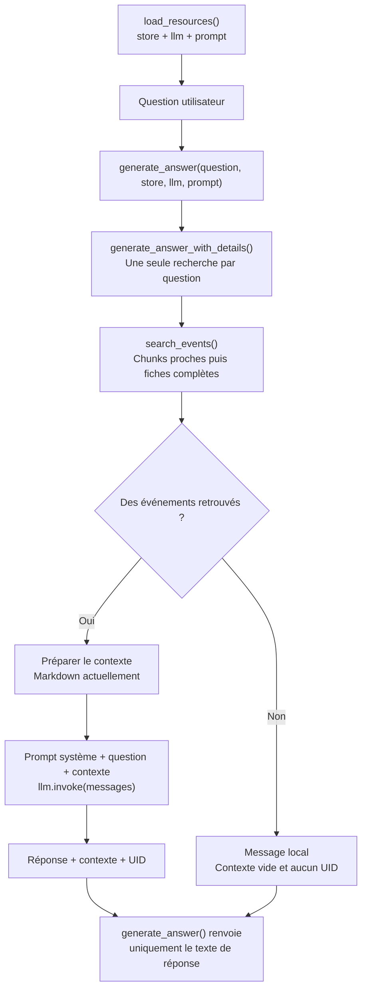
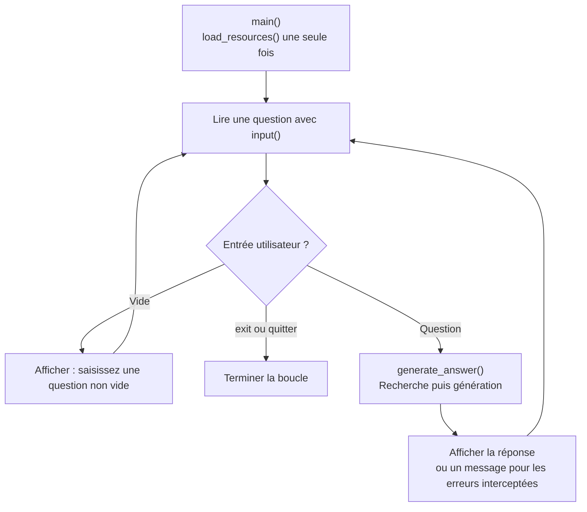

# Comprendre `chatbot.py` sans lire tout le code

**Mission :** rechercher les événements pertinents pour une question, retrouver leurs fiches complètes et transmettre ce contexte à Mistral pour produire une réponse en français.

<table>
<tr><th>ENTRÉES</th><th>TRANSFORMATION</th><th>SORTIES</th></tr>
<tr><td>Question de l’utilisateur Index FAISS + DocStore existants Prompt système et clé Mistral</td><td>Vectoriser la question → rechercher des chunks → retrouver les événements → préparer le contexte → générer</td><td>Texte de réponse Avec la fonction détaillée : contexte envoyé et UID retrouvés</td></tr>
</table>

**Fil conducteur :** l’événement fictif **Festival de jazz**, UID **12345**. La question d’exemple est : « Où se déroule le Festival de jazz ? ». Les extraits de documents et les distances sont illustratifs ; ils ne représentent pas une exécution réelle.

Le fichier [chatbot.py](../chatbot.py) utilise les ressources déjà produites par [build_index.py](../build_index.py). Il ne collecte pas d’événements, ne refait pas le chunking et ne reconstruit pas l’index. **Les vecteurs des événements sont réutilisés ; les nouvelles questions sont vectorisées avec Mistral.**

## 1. Deux usages, une même logique RAG

<table>
<tr><th>LANCER LE FICHIER EN TERMINAL</th><th>IMPORTER LES FONCTIONS</th></tr>
<tr><td><code>if __name__ == "__main__"</code> ↓ <code>main()</code> ↓ Charger les ressources, puis lire les questions dans une boucle</td><td>L’import ne lance pas le terminal. L’appelant utilise <code>load_resources()</code>, puis <code>generate_answer()</code> ou <code>generate_answer_with_details()</code>.</td></tr>
</table>

Les quatre arguments de `generate_answer()` sont explicites : la question et les trois ressources préparées. La réutilisation de ces ressources dépend de l’appelant ; `load_resources()` n’est pas un cache automatique. Dans le terminal, `main()` la lance une fois avant la boucle. L’API réutilise également les ressources qu’elle charge au démarrage.

## 2. Préparer les ressources — `load_resources()`

<table>
<tr><th>CE QUI ENTRE</th><th>CE QUE LA FONCTION FAIT</th><th>CE QUI SORT</th></tr>
<tr><td>Fichiers locaux et configuration Aucun argument Python</td><td>Lire le prompt. Vérifier les fichiers de l’index. Configurer les clients Mistral. Charger FAISS et le DocStore en mémoire.</td><td><code>(store, llm, prompt)</code> Magasin documentaire, client de génération et texte des instructions</td></tr>
</table>

<table>
<tr><th>RESSOURCE</th><th>RÔLE ET CONTRÔLES</th></tr>
<tr><td><code>App/RAG/prompt_system_chatbot.md</code></td><td>Instructions envoyées dans le message système. Le fichier est lu en UTF-8 et doit contenir un texte non vide.</td></tr>
<tr><td><code>App/Data/vector_store/Vector_Store.faiss</code></td><td>Index chargé avec <code>faiss.read_index()</code>. Il doit contenir au moins un vecteur et sa dimension doit être 1 024.</td></tr>
<tr><td><code>App/Data/vector_store/DocStore_LangChain.pkl</code></td><td><code>pickle.load()</code> restitue le DocStore et la correspondance position FAISS → identifiant. Le dossier et les deux fichiers doivent exister et ne pas être des liens symboliques.</td></tr>
<tr><td><code>MISTRAL_API_KEY</code></td><td>Clé non vide, lue depuis l’environnement après chargement de <code>.env</code> sans écraser les variables déjà définies.</td></tr>
<tr><td><code>MistralAIEmbeddings</code></td><td>Client du modèle <code>mistral-embed</code>, associé au magasin FAISS pour vectoriser les questions. Aucun embedding d’événement n’est recalculé ici.</td></tr>
<tr><td><code>ChatMistralAI</code></td><td>Client du modèle <code>ministral-8b-2512</code>, configuré avec <code>temperature=0</code> et <code>max_retries=0</code>.</td></tr>
</table>

Les noms des deux fichiers étant différents, le code les charge séparément puis assemble `FAISS(embeddings, index, docstore, index_to_docstore_id)`. Les clients Mistral permettent d’utiliser des modèles distants : ils ne chargent pas les poids de ces modèles sur l’ordinateur. La température 0 vise à limiter la variabilité, sans garantir l’exactitude ni un résultat strictement identique à chaque appel.

**Sécurité :** le chargement pickle est réservé aux fichiers locaux de confiance produits par l’application ; un fichier malveillant pourrait exécuter du code. Vérifier sa présence ou sa dimension ne prouve pas l’authenticité du fichier.

## 3. Rechercher les événements — `search_events(question, store)`

<table>
<tr><th>ENTRÉE</th><th>TRAITEMENT</th><th>SORTIE</th></tr>
<tr><td>Question textuelle non vide Magasin FAISS chargé</td><td><code>similarity_search_with_score()</code> vectorise la question via LangChain et recherche jusqu’à 20 chunks. Parcourir les résultats et conserver au maximum cinq événements distincts.</td><td>Une liste de tuples : <code>(reference, rank, distance)</code> Document complet, rang de l’événement et distance du premier chunk rencontré pour cet UID</td></tr>
</table>

<table>
<tr><th>RÉSULTATS FAISS ILLUSTRATIFS</th><th>DÉCISION DU CODE</th></tr>
<tr><td><code>12345_1</code> · UID 12345 · distance 0,24</td><td>Premier passage de cet événement : lire <code>event_12345</code> dans le DocStore et retenir la fiche au rang 1.</td></tr>
<tr><td><code>12345_4</code> · UID 12345 · distance 0,31</td><td>Événement déjà retenu : ignorer ce doublon sans ajouter une seconde fiche.</td></tr>
<tr><td>Autres chunks éventuels</td><td>Continuer dans l’ordre des résultats, jusqu’à cinq UID différents ou épuisement des 20 chunks.</td></tr>
</table>

Pour chaque fiche, le code vérifie que le document existe, que `metadata.event` est un dictionnaire et que ses UID correspondent au chunk. Une fiche absente ou incohérente provoque une erreur, avec une invitation à reconstruire l’index.

**À comprendre :** les 20 résultats sont des chunks, pas nécessairement 20 événements. Le rang renvoyé numérote les événements distincts retenus. Une distance plus faible indique un passage plus proche ; elle n’est pas un pourcentage de confiance. Le code ne fixe aucun seuil de pertinence et ne filtre pas explicitement les dates ou l’âge du public.

## 4. Préparer le contexte — deux présentations disponibles

Les deux fonctions reçoivent la liste `(reference, rank, distance)` et renvoient une chaîne de caractères. Elles utilisent les **fiches complètes**, pas uniquement le texte des chunks retrouvés.

<table>
<tr><th>FONCTION</th><th>TRANSFORMATION</th><th>CONFIGURATION ACTUELLE</th></tr>
<tr><td><code>build_context(events)</code></td><td>Produire un JSON indenté contenant toutes les métadonnées des références, leur rang et leur distance FAISS, sans filtrage ni troncature.</td><td>Alternative disponible si <code>USE_MARKDOWN_CONTEXT = False</code>.</td></tr>
<tr><td><code>build_markdown_context(events)</code></td><td>Présenter les événements sous des titres et rubriques, avec des libellés français. Conserver les informations métier et alléger les objets de liens.</td><td>Utilisée actuellement : <code>USE_MARKDOWN_CONTEXT = True</code>.</td></tr>
</table>

<table>
<tr><th>FICHE DANS LE DOCSTORE</th><th>EXTRAIT DU CONTEXTE MARKDOWN</th></tr>
<tr><td><pre>metadata.event :
  uid : 12345
  title : "Festival de jazz"
  location_name : "Salle du festival"
  age_min : 6
  timings : [...]
  …</pre>Exemple fictif, abrégé.</td><td><pre>## Festival de jazz — UID 12345
Classement FAISS : 1
Distance FAISS du meilleur chunk : 0.24

### Lieu et accès
#### Lieu
Salle du festival

### Public et accessibilité
#### Âge minimum
6</pre>Les autres champs présents sont rendus également.</td></tr>
</table>

<table>
<tr><th>MÉCANISME DE MISE EN FORME</th><th>COMPORTEMENT</th></tr>
<tr><td>Rubriques</td><td>Présentation ; dates et horaires ; lieu et accès ; public et accessibilité ; conditions et liens utiles ; source et statut. Les champs non classés vont dans « Autres informations ».</td></tr>
<tr><td><code>render(value, depth=0)</code></td><td>Fonction interne à <code>build_markdown_context()</code>, pas une fonction publique. Déplie récursivement listes et dictionnaires ; les conteneurs vides, <code>None</code> et chaînes vides deviennent « Non renseigné ». Les valeurs <code>0</code> et <code>false</code> sont conservées.</td></tr>
<tr><td>Liens intégrés</td><td>Conserver les champs utiles <code>link</code>, <code>title</code>, <code>url</code> et les descriptions des liens non vidéo ; écarter les autres champs techniques de ces objets.</td></tr>
<tr><td>Liens vidéo</td><td>Reconnaître un type <code>video</code> ou une adresse YouTube/Vimeo ; garder les titres et adresses disponibles, mais pas les descriptions de vidéos.</td></tr>
<tr><td>Documents d’origine</td><td>Ne pas modifier les événements du DocStore. Les descriptions longues et horaires sont conservés dans le contexte lorsqu’ils sont présents.</td></tr>
</table>

La mise en forme n’est pas un résumé par un LLM et ne réduit pas automatiquement le contexte à un budget de tokens. Le Markdown reste du texte transmis à l’API : ce n’est pas l’envoi d’un fichier `.md` en pièce jointe. Les caractères d’échappement visibles dans un export JSON ne suffisent pas, à eux seuls, à prouver que le modèle reçoit un texte mal formé.

## 5. Générer une réponse — `generate_answer_with_details()`

<table>
<tr><th>ENTRÉES</th><th>ORCHESTRATION</th><th>SORTIE</th></tr>
<tr><td><code>question, store, llm, prompt</code></td><td>Une recherche avec <code>search_events()</code>. Créer le contexte selon la configuration. Construire les deux messages. Appeler <code>llm.invoke(messages)</code>. Vérifier une réponse textuelle non vide.</td><td>Un dictionnaire : <code>answer</code> <code>context</code> <code>retrieved_uids</code></td></tr>
</table>

<table>
<tr><th>MESSAGE</th><th>CONTENU ENVOYÉ À MISTRAL</th></tr>
<tr><td><code>SystemMessage</code></td><td>Le texte du fichier <code>prompt_system_chatbot.md</code>, lu comme texte libre, sans substitution de variables.</td></tr>
<tr><td><code>HumanMessage</code></td><td><pre>Question :
Où se déroule le Festival de jazz ?

Fiches d’événements (Markdown) :
## Festival de jazz — UID 12345
…</pre>Le contexte complet est ajouté à la question, après suppression de ses espaces extérieurs.</td></tr>
</table>

<table>
<tr><th>ÉLÉMENT RETOURNÉ</th><th>RÔLE</th></tr>
<tr><td><code>answer</code></td><td>Texte produit par le modèle, destiné à l’utilisateur.</td></tr>
<tr><td><code>context</code></td><td>Exactement le texte documentaire inséré dans le message utilisateur ; il ne contient ni le prompt système ni toute la requête complète.</td></tr>
<tr><td><code>retrieved_uids</code></td><td>UID des fiches sélectionnées, dans leur ordre, par exemple <code>[12345]</code>.</td></tr>
</table>

Ces détails sont utiles à l’évaluation : observer la réponse et le contexte issus du **même appel de recherche**. Les réponses humaines attendues du jeu d’évaluation ne sont jamais injectées dans ce parcours de génération.

Si aucun événement n’est retrouvé, la fonction renvoie directement « Aucun événement n’a été retrouvé pour cette question. », avec un contexte vide et une liste d’UID vide. **Le modèle de génération n’est pas appelé dans cette branche**, mais la recherche a déjà vectorisé la question. Ce cas n’est pas un mécanisme de rejet des passages peu pertinents, puisqu’aucun seuil de distance n’est appliqué.

## 6. Renvoyer seulement le texte — `generate_answer()`

<table>
<tr><th>ENTRÉES</th><th>TRAITEMENT</th><th>SORTIE</th></tr>
<tr><td>Les mêmes quatre arguments : <code>question, store, llm, prompt</code></td><td>Appeler <code>generate_answer_with_details()</code>, puis lire la clé <code>answer</code>.</td><td>Une chaîne de caractères, directement affichable par le terminal ou retournable par l’API.</td></tr>
</table>

Cette fonction est une interface courte : elle ne duplique ni la recherche ni la génération. L’appelant choisit entre une réponse simple et les détails nécessaires à l’évaluation. Les exceptions restent transmises à l’interface appelante, qui décide comment les présenter.

## 7. Faire fonctionner le terminal — `main()`

<table>
<tr><th>CAS GÉRÉ DANS LE TERMINAL</th><th>COMPORTEMENT</th></tr>
<tr><td>Erreur de chargement interceptée</td><td>Afficher un message et ne pas entrer dans la boucle.</td></tr>
<tr><td>HTTP Mistral 400, 413 ou 422</td><td>Inviter à vérifier notamment la taille du contexte ; le code ne le tronque pas automatiquement.</td></tr>
<tr><td>Autre erreur de statut HTTP</td><td>Afficher le statut et inviter à vérifier clé, quotas ou disponibilité.</td></tr>
<tr><td>Erreur réseau ou délai HTTPX</td><td>Afficher un message de connexion et permettre une nouvelle question.</td></tr>
<tr><td><code>ValueError</code> pendant la réponse</td><td>Afficher l’erreur et poursuivre la boucle.</td></tr>
<tr><td><code>exit</code>, <code>quitter</code>, <code>Ctrl+C</code> ou fin d’entrée</td><td>Quitter avec un message. La saisie reconnaît aussi les majuscules des mots de sortie.</td></tr>
</table>

Ce tableau décrit les exceptions explicitement interceptées dans ce fichier, pas toutes les exceptions possibles des bibliothèques. L’API possède sa propre gestion HTTP, distincte de cette interface terminal. Chaque génération crée un nouveau couple de messages : **les questions précédentes ne sont pas transmises comme historique**, même si les ressources restent chargées.

## 8. Forces, limites et réutilisation

<table>
<tr><th>CHOIX</th><th>AVANTAGE</th><th>POINT D’ATTENTION</th></tr>
<tr><td>Ressources réutilisables</td><td>Ne pas relire l’index et le prompt à chaque question lorsque l’appelant conserve les objets.</td><td>Ils occupent la mémoire ; une modification des fichiers n’est pas automatiquement rechargée.</td></tr>
<tr><td>Recherche par chunks, réponse depuis les fiches</td><td>Passages ciblés pour sélectionner les événements, informations complètes pour répondre.</td><td>Cinq événements distincts maximum, même si d’autres seraient utiles ; aucun filtre déterministe d’âge ou de date.</td></tr>
<tr><td>Contexte Markdown</td><td>Rubriques lisibles et informations métier conservées.</td><td>Les descriptions complètes peuvent produire une requête longue ; aucune mesure automatique du budget de tokens.</td></tr>
<tr><td>Prompt séparé du contexte</td><td>Instructions modifiables indépendamment des données et de la recherche.</td><td>Le prompt seul ne garantit pas l’absence d’invention ni la résistance aux injections d’instructions.</td></tr>
<tr><td>Deux fonctions de réponse</td><td>Une interface simple et une interface détaillée, sans seconde recherche.</td><td>Le contexte retourné n’est pas une preuve que chaque phrase générée est justifiée.</td></tr>
<tr><td>Modèles distants</td><td>Aucun modèle de génération à héberger localement.</td><td>Internet, clé valide et quotas nécessaires ; question et fiches sont transmises à Mistral.</td></tr>
</table>

<table>
<tr><th>COMMENT LES AUTRES PARTIES DE L’APPLICATION LE RÉUTILISENT</th></tr>
<tr><td><strong>Terminal :</strong> <code>main()</code> charge les ressources et affiche <code>generate_answer()</code>. <strong>API :</strong> charge et conserve les ressources, puis appelle la même fonction métier pour les requêtes. <strong>Évaluation :</strong> utilise <code>generate_answer_with_details()</code> pour comparer la réponse et analyser le contexte réellement utilisé.</td></tr>
</table>

Les paramètres actuels sont `mistral-embed`, `ministral-8b-2512`, `SEARCH_K = 20`, `MAX_EVENTS = 5` et `USE_MARKDOWN_CONTEXT = True`. Ce document explique leur utilisation dans le code ; il ne constitue pas une mesure de qualité ni une preuve d’exécution.
