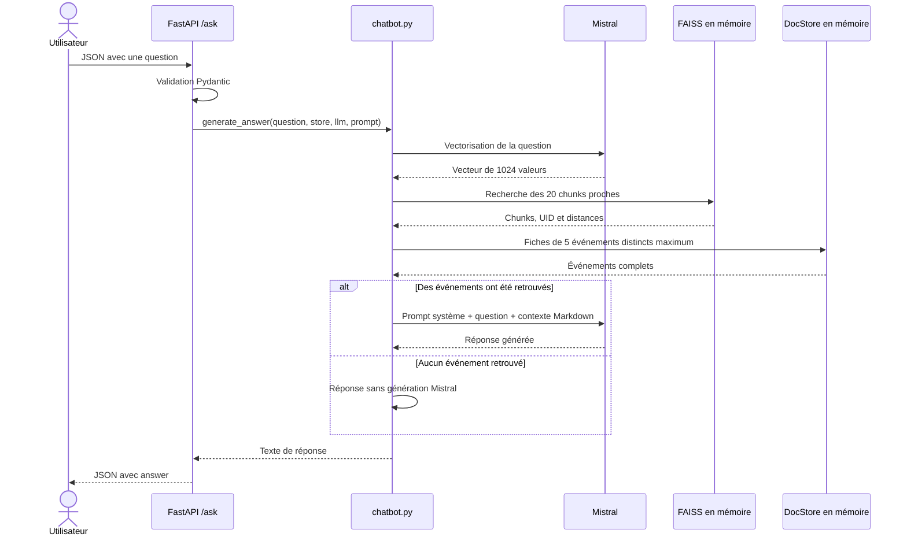

# Rapport technique – Assistant intelligent de recommandation d’événements culturels

**Projet OpenClassrooms IA Engineer, RNCP niveau 7 — POC Puls-Events, Toulouse.**

Ce rapport suit les dix sections du modèle fourni. Il décrit le code actuel et les résultats enregistrés jusqu’au **30 octobre 2026**. Résultats d’exécution, observations humaines et perspectives sont distingués. Les procédures d’installation et d’utilisation figurent dans le [README](../README.md).

## 1. Objectifs du projet

### Contexte

Dans le cadre de la mission confiée par **Puls-Events**, ce projet développe un assistant capable de recommander des événements à partir d’une question en langage naturel. Le prototype exploite les données publiques OpenAgenda pour répondre en français sur les événements de Toulouse. La mission est traitée comme un POC : il ne s’agit pas d’un service déjà déployé en production auprès de clients.

### Problématique métier

Un utilisateur exprime un besoin avec un thème, une période, un âge ou une contrainte d’accessibilité, sans connaître le titre exact d’un événement. La recherche sémantique retrouve des passages proches de cette demande ; un modèle de langage présente ensuite les informations pratiques.

Le RAG fournit au modèle des fiches identifiées plutôt que de lui demander de répondre uniquement avec ses connaissances d’entraînement. Il rend la sélection et le contexte inspectables, sans garantir à lui seul l’exactitude ou le respect de tous les critères métier.

### Objectif du POC

| Dimension | Ce que le projet cherche à démontrer | Éléments disponibles |
|---|---|---|
| Faisabilité technique | Collecter, préparer, vectoriser, rechercher puis générer via une API. | Pipeline Python, FAISS, FastAPI et démarrage Docker automatique. |
| Valeur métier | Répondre à des questions factuelles et recommander des événements adaptés. | Jeu annoté, exemples et essai Swagger ; aucun gain utilisateur chiffré n’a été mesuré. |
| Qualité et robustesse | Mesurer la récupération, la génération et les erreurs. | Tests, couverture, Ragas et revue de cas limites. |
| Reproductibilité | Installer et démontrer sur un autre poste. | Dépendances figées, Dockerfile, variables de configuration et README. |

### Périmètre

- **Zone :** Toulouse, filtrée avec `adminLevel4=Toulouse` dans OpenAgenda.
- **Période :** depuis minuit UTC un an avant la collecte, sans borne supérieure sur les événements futurs. Les questions annotées portent notamment sur octobre 2026 ; ce n’est pas la limite temporelle de la collecte.
- **Données :** événements publiés, descriptions, séances, lieux, publics, âges, conditions, liens et accessibilité disponibles dans OpenAgenda.
- **Usage :** terminal et API locale ; un utilisateur, un worker et des appels successifs, sans historique conversationnel ni gestion de concurrence.

## 2. Architecture du système

### Schéma global UML

Les blocs représentent les composants logiques, avec une notation UML de classes stéréotypées Mermaid. Ce ne sont pas des classes Python supplémentaires. Les flèches en pointillés indiquent les dépendances et leur rôle.


La préparation des données est distincte du traitement des questions. Terminal, FastAPI et évaluation réutilisent la logique de recherche et de génération de `chatbot.py`.

### Technologies et rôle des composants

| Composant / technologie | Fichier principal | Rôle et justification |
|---|---|---|
| Python 3.13, Requests | `App/API/openagenda.py` | Collecte paginée avec session HTTP et délais réseau. |
| JSON, bibliothèque standard | `App/Preprocessing/preprocess_openagenda.py` | Structurer les événements sans modifier les RAW. |
| Documents et découpeurs LangChain | `App/RAG/build_embeddings.py` | Associer texte et identification ; découper les thèmes. |
| API Mistral | `build_embeddings.py`, `chatbot.py` | Produire vecteurs et réponses sans hébergement local des modèles. |
| FAISS et DocStore LangChain | `App/RAG/build_index.py` | Recherche locale et accès aux fiches par UID, sans serveur de base de données. |
| LangChain | `App/RAG/chatbot.py` | Relier embeddings, recherche, contexte et messages de génération. |
| FastAPI, Pydantic, Uvicorn | `App/API/rag_api.py` | Valider les contrats HTTP et exposer OpenAPI/Swagger. |
| Docker et uv | `Dockerfile`, `docker_entrypoint.py` | Installer les dépendances et préparer les ressources avant le serveur. |
| Pytest, pytest-cov | `tests/`, `tests/run_tests.py` | Tester le fonctionnement et produire rapports et couverture. |
| Ragas, LiteLLM, Instructor | `App/Evaluation/evaluate_rag.py` | Évaluer avec un juge LLM et des sorties structurées. |
| HTML local | `App/Evaluation/generate_report.py` | Consulter scores, erreurs et contextes sans nouvel appel API. |

### Parcours d’une question



L’API charge l’index, le prompt et les clients Mistral une fois au démarrage. Chaque question est vectorisée avec `mistral-embed` ; les 20 chunks proches servent à retenir les cinq premiers événements distincts. Leurs fiches `event_<uid>` alimentent le contexte du générateur. Une distance FAISS n’est ni une probabilité ni un pourcentage de confiance.

### Conteneurisation

L’image repose sur `python:3.13-slim-bookworm`, installe le `requirements.txt` avec uv et ajoute `libgomp1` pour les calculs natifs. Elle embarque les scripts et le prompt ; `.env`, données locales, environnement Windows, tests et notebooks sont exclus. L’exécution utilise un utilisateur non privilégié et Uvicorn sur `0.0.0.0:8000`, avec un worker.

`docker_entrypoint.py` orchestre collecte → prétraitement → embeddings → FAISS → API. Les données sont créées sous `/app/App/Data/`, sans montage Windows. Les étapes déjà terminées sont réutilisées ; un index présent évite collecte et vectorisation. Une erreur du pipeline ou du chargement du RAG bloque le démarrage. Redémarrer le même conteneur conserve ses données ; le supprimer les efface.

## 3. Préparation et vectorisation des données

### Source et paramètres OpenAgenda

| Appel / paramètre | Valeur ou règle dans le code |
|---|---|
| API | `https://api.openagenda.com/v2` |
| Sélection des agendas | `/agendas`, `locationSet=15245864`, `size=100`. |
| Schéma de référence | `/agendas/42448083`, `detailed=1`, pour décoder les catégories. |
| Événements | `/agendas/{uid}/events` pour chaque agenda sélectionné. |
| Filtres | `adminLevel4=Toulouse`, `state=2` (publiés), `timings[gte]` calculé un an avant la collecte. |
| Détail et pagination | `detailed=1`, `size=100`, puis curseur `after[]`. |
| Réseau | Clé `OPENAGENDA_API_KEY` en en-tête ; connexion 10 s, lecture 30 s ; redirections désactivées. |

Les RAW horodatés conservent les événements, agendas sources, schéma de référence et provenance. Un curseur répété ou une pagination qui ne progresse plus provoque une erreur. Les doublons sont conservés par la collecte puis traités au prétraitement.

### Nettoyage et structuration

| Anomalie ou structure traitée | Méthode réellement implémentée |
|---|---|
| Événement présent dans plusieurs agendas | Dédoublonnage par UID numérique ; première occurrence conservée, sans fusion. |
| UID absent ou inexploitable | Événement écarté et compté séparément. |
| Texte multilingue | Extraction du français ; aucune traduction ou description inventée si absent. |
| Catégories sous forme d’identifiants | Décodage avec le schéma de référence ; identifiants inconnus conservés avec avertissement. |
| Objets `location`, `age`, `originAgenda` absents | Lecture avec un dictionnaire vide ; champs manquants conservés comme valeurs absentes. |
| Accessibilité | Codes explicitement `True` conservés avec libellés. Une liste vide ne confirme ni accès ni inaccessibilité. |
| Statut métier numérique | Traduction des codes connus ; valeurs inconnues conservées. |
| Plusieurs séances | Conservation intégrale de `timings`, pas seulement de la première date. |

Ces exemples décrivent les traitements du code, sans inventer de nombre d’anomalies corrigées. Le JSON prétraité conserve `source_file`, `processed_at`, compteurs et `events`. Les écritures RAW et prétraitées passent par un temporaire avant publication ; le prétraitement ne modifie pas le RAW.

### Chunking structuré

Les sections sont présentation, informations pratiques, public/accessibilité et description longue si présente. Ce regroupement vise à retrouver un passage ciblé plutôt qu’un événement entier contenant plusieurs sujets.

Chaque `Document` LangChain contient `page_content` et des métadonnées minimales. La limite de **2 048 caractères inclut l’en-tête** : titre, section et éventuelle numérotation. Une section courte reste entière ; sinon, `RecursiveCharacterTextSplitter` essaie paragraphes, lignes, espaces puis caractères. Le chevauchement visé est de **150 caractères**, potentiellement inférieur selon les séparateurs. Il ne s’agit pas de tokens.

La règle s’applique à toutes les sections, avec conservation des séparateurs et espaces. Les champs non affectés vont dans les informations pratiques, sauf `long_description`, traitée à part, et `timings`, exclu du texte vectorisé mais conservé dans la fiche complète.

### Embeddings et reprise

| Paramètre | Configuration |
|---|---|
| Modèle | `mistral-embed`, via `MistralAIEmbeddings` ; seul `page_content` est envoyé. |
| Dimension | 1 024 valeurs numériques finies par chunk. |
| Lots | Jusqu’à 32 textes ; contrôle du nombre et de la dimension des vecteurs reçus. |
| Format | `App/Data/embeddings/embeddings.jsonl`, une ligne par lot : textes, métadonnées et vecteurs, format, modèle et total attendu. |
| Reprise | Comparer total, nombre, ordre, textes, métadonnées et vecteurs des lots sauvegardés aux chunks actuels. |

Les lots valides sont conservés ; seule une dernière ligne incomplète reconnue peut être retirée. Une autre corruption bloque la reprise. Les écritures utilisent `flush()` et `os.fsync()`. Un lot reçu mais non sauvegardé peut devoir être recalculé. Tous les chunks restent en mémoire, et les vecteurs sont générés par lots. Il faut conserver le même JSON prétraité pendant la reprise.

## 4. Choix du modèle NLP

### Modèles sélectionnés et critères

| Modèle | Rôle | Justification et réserve |
|---|---|---|
| `mistral-embed` | Représenter événements et questions dans un même espace vectoriel. | Configuration reprise du notebook, intégration LangChain et fournisseur commun. Changer de modèle nécessite de régénérer les vecteurs et l’index. |
| `ministral-8b-2512` | Générer en français depuis les fiches. | Usage de l’API déjà intégrée, sans héberger un LLM ; température 0 pour limiter la variabilité. |
| `ministral-8b-2512` par défaut | Juge Ragas. | Configuration simple et modifiable par `--judge-model`, mais pas de jugement indépendant du générateur. |

Coût, qualité et compatibilité sont des critères de choix. Aucun benchmark comparatif de modèles, coût par réponse ou mesure de latence n’est fourni : ce modèle n’est donc pas présenté comme le moins cher, le plus rapide ou le meilleur. Les résultats du POC permettent d’observer ses limites en français.

### Prompting et structure

Le fichier [prompt_system_chatbot.md](../App/RAG/prompt_system_chatbot.md) est distinct du code. Le système envoie un `SystemMessage` contenant ces instructions et un `HumanMessage` contenant question et fiches. Le contexte est actuellement en Markdown ; le prompt actuel demande des réponses en texte brut, adaptées à la complexité de la demande.

Les consignes encadrent le rôle toulousain, l’usage exclusif des événements fournis, les critères de dates/âges/accessibilité et le signalement des informations absentes. Les fiches sont des données, pas des instructions. Le classement FAISS est une indication de proximité, pas une preuve d’adéquation métier.

`build_context()` et `build_markdown_context()` préparent les fiches sans nouveau résumé LLM. Le Markdown regroupe les champs et allège les objets de liens ; descriptions longues et horaires restent disponibles. Aucun budget de tokens ne tronque automatiquement le contexte.

### Limites du modèle

La température 0 ne garantit ni déterminisme strict, ni exactitude, ni résistance aux instructions adverses. Les réponses dépendent des documents retrouvés, d’Internet et des quotas. Aucun historique n’est transmis. Un prompt plus strict ne prouve pas son efficacité : chaque résultat doit être rattaché à l’empreinte du prompt évalué, pas à toute version modifiée ensuite.

## 5. Construction de la base vectorielle

### FAISS utilisé

`FAISS.from_embeddings()` reçoit les vecteurs déjà sauvegardés. Dans l’intégration LangChain installée, les paramètres par défaut employés créent un **`IndexFlatL2`**, sans normalisation L2 demandée par le script. La recherche est exacte, sur la distance L2 au carré ; ce n’est ni HNSW/IVF ni une similarité cosinus explicitement configurée.

Ce choix évite l’entraînement d’un index et des réglages supplémentaires, ce qui convient au POC. La recherche parcourt les vecteurs et le stockage en mémoire croît avec le jeu. Aucun temps de réponse garanti n’est déduit sans benchmark.

### Métadonnées et documents

| Objet | Contenu | Rôle |
|---|---|---|
| Chunk vectorisé | Texte, `uid`, `chunk_id`, `chunk_index`, `section` ; si fragmenté, `part`, `total_parts` et liens vers les fragments voisins. | Retrouver le passage et identifier son événement. |
| Fiche `event_<uid>` | Texte d’identification et `metadata={"uid": uid, "event": événement_complet}`. | Conserver toutes les informations, notamment `timings`, sans vecteur supplémentaire. |
| Correspondance interne | Position FAISS → identifiant du chunk. | Relier le résultat numérique au document LangChain. |

`ExistingEmbeddings` respecte l’interface LangChain mais bloque toute demande de vectorisation. `store.docstore.add()` ajoute les fiches sans les vectoriser. Un événement peut donc avoir plusieurs vecteurs de chunks et une seule fiche complète.

### Persistance et reconstruction

| Chemin | Contenu |
|---|---|
| `App/Data/vector_store/Vector_Store.faiss` | Index numérique des chunks. |
| `App/Data/vector_store/DocStore_LangChain.pkl` | Documents des chunks, fiches complètes et correspondance des identifiants. |

L’index est construit en mémoire et sauvegardé une fois avec `save_local()` dans un temporaire sous Data. Les fichiers `index.faiss` et `index.pkl` sont renommés, vérifiés puis publiés par renommage du dossier. `main()` refuse une destination existante.

`rebuild_index()` prépare une nouvelle base, conserve l’ancienne et laisse l’appelant recharger les ressources dans un bloc `with`. Une exception déclenche une tentative de restauration. Une sauvegarde précédente encore présente doit être examinée avant une nouvelle reconstruction. Ce mécanisme n’est pas une garantie contre toute coupure brutale et ne gère pas la concurrence.

Les vecteurs et fiches doivent provenir du même jeu prétraité. Le script contrôle structure et UID, mais ne recalcule pas les chunks pour vérifier leur identité avec le dernier JSON. Le pickle doit provenir de l’application et rester de confiance : sa lecture peut exécuter du code.

## 6. API et endpoints exposés

### Framework, contrats et ressources

FastAPI expose les fonctions métier de `chatbot.py`, Pydantic valide les entrées et Uvicorn sert l’application. L’index, le prompt et les clients Mistral sont conservés en mémoire ; les vecteurs des événements ne sont pas recalculés pour chaque question.

| Route | Entrée | Réponse nominale | Fonction |
|---|---|---|---|
| `GET /health` | Aucun corps. | `{"status":"API disponible."}` | Vérifier le serveur HTTP, sans question à Mistral. |
| `POST /ask` | `{"question":"…"}` ; chaîne stricte non vide, de 1 à 4 000 caractères ; champs supplémentaires refusés. | `{"answer":"…"}` | Recherche et génération. |
| `POST /rebuild` | Aucun corps ; `Authorization: Bearer <token>`. | `{"status":"Index reconstruit."}` | Reconstruire depuis les embeddings et événements existants, puis recharger les ressources. |

`/rebuild` ne relance ni OpenAgenda, ni le prétraitement, ni les embeddings. Choisir un token secret dans `RAG_ADMIN_TOKEN` et le saisir à l’identique dans **Authorize** de Swagger, sans préfixe `Bearer`. Aucun token de démonstration public n’est recommandé.

### Exemple d’appel API en Python

```python
import requests

response = requests.post(
    "http://127.0.0.1:8000/ask",
    json={"question": "Où se déroule le ciné-concert C.A.V.E.R.N.E.S. du 28 octobre 2026 ?"},
    timeout=120,
)
response.raise_for_status()
print(response.json()["answer"])
```

Cet exemple suppose le serveur démarré et consomme de l’usage Mistral s’il est exécuté. Swagger est disponible sur `http://127.0.0.1:8000/docs` et le schéma OpenAPI sur `/openapi.json`.

### Tests et gestion des erreurs

`tests/test_rag_api.py` utilise TestClient et des services simulés pour question valide, question vide, ressources indisponibles, authentification et reconstruction réussie/échouée. La section 7 présente les résultats agrégés ; ces tests ne remplacent pas les essais réels Mistral.

| Statut | Situation principale |
|---|---|
| `401` | Authentification administrateur absente ou incorrecte. |
| `422` | Question ou requête invalide : absence, blanc, type, longueur ou champ supplémentaire. |
| `429` | Limite de débit ou quota Mistral. |
| `502` | Communication ou génération échouée. |
| `503` | Ressources indisponibles, administration non configurée ou reconstruction échouée. |
| `504` | Délai Mistral dépassé. |

Le code traduit les erreurs HTTPX et celles enveloppées dans `RetryError` de Tenacity. Les réponses HTTP masquent les corps bruts des erreurs distantes. Le chargement initial journalise le type d’erreur. Hors Docker, l’API peut rester disponible sans RAG : `/health` ne garantit pas `/ask`. Le démarrage Docker exige un chargement réussi.

Un seul worker et des appels successifs sont prévus, sans verrou. `/ask` n’est pas authentifié ; publier sur `127.0.0.1:8000` est recommandé. Cette configuration n’est pas prête pour exposition publique.

## 7. Évaluation du système

### Jeu annoté et méthode d’annotation

Le fichier versionné [App/Evaluation/question.json](../App/Evaluation/question.json) contient **12 exemples** : dix questions métier et deux tentatives d’injection d’instructions. Chaque entrée associe identifiant, catégorie, question, réponse humaine attendue et UID attendus. Les références correspondent à des informations des fiches : lieu, titre, horaires, conditions ou absence d’information.

C’est une annotation de référence fournie pour le projet, sans protocole documenté à plusieurs annotateurs ni mesure d’accord interannotateurs. Les références courtes et les ensembles d’UID limités influencent les scores ; une recommandation différente peut être pertinente sans figurer dans les UID attendus.

Avant les appels payants, le script vérifie exactement 12 identifiants uniques Q01 à Q12, les champs obligatoires et des UID entiers positifs non dupliqués. Seules Q11/Q12 exigent une liste d’UID vide. Des exemples figurent en annexe.

### Métriques et protocole

`generate_answer_with_details()` réalise une seule recherche par question et renvoie réponse, contexte réellement envoyé et UID sélectionnés. Les références humaines ne sont pas injectées dans la génération. Les métriques Ragas concernent Q01 à Q10 ; Q11/Q12 sont conservées séparément pour examen humain.

| Mesure | Ce qu’elle mesure | Réserve |
|---|---|---|
| Recall@5 des UID, Python | Part des UID attendus parmi les cinq événements maximum retenus. | Dépend des annotations ; pas un taux de réponses correctes. |
| Faithfulness | Justification des affirmations par le contexte, selon le juge. | Ne prouve pas l’exactitude des sources ni le respect de tous les critères métier. |
| Answer Relevancy | Pertinence pour la question ; `strictness=3`. | Un refus justifié peut recevoir un score faible. |
| Factual Correctness F1, historique | Correspondance combinant précision et rappel par rapport à la référence. | Les ajouts absents d’une référence courte peuvent être pénalisés, même s’ils sont documentés. |
| Factual Correctness en rappel, actuelle | Couverture des faits attendus, nom affiché dans le tableau de bord. | Ne valide pas seule les ajouts ; conserver Faithfulness et une revue humaine. |

Le juge par défaut est `ministral-8b-2512`, comme le générateur ; la télémétrie Ragas est désactivée. Aucun score de satisfaction ni seuil bloquant de qualité n’est implémenté. Les moyennes indiquent leur effectif ; erreurs techniques, valeurs non calculées et scores faibles sont distincts.

### Résultats techniques enregistrés

Le dernier `resultats.xml` consulté, du **30 octobre 2026 à 08 h 12**, indique **236 tests, 0 échec, 0 erreur, 0 ignoré**, pour **44,769 secondes** enregistrées. La couverture associée est de **787 lignes exécutées sur 825**, soit **95,39 %**.

| Script | Couverture de lignes |
|---|---:|
| `build_embeddings.py` | 92,97 % |
| `build_index.py` | 91,10 % |
| `chatbot.py` | 95,00 % |
| `openagenda.py` | 98,28 % |
| `preprocess_openagenda.py` | 99,26 % |
| `rag_api.py` | 98,80 % |

Sources : `App/Data/resultats_tests_unitaires/resultats.xml` et `couverture.xml`. Les services sont simulés ; la mesure porte sur `App/API`, `App/Preprocessing` et `App/RAG`, sans les outils d’évaluation ni l’orchestrateur Docker. Elle ne démontre ni la qualité des réponses ni tous les scénarios de panne. Le résultat précédent du 29 octobre était de 95,5 % (786/823) : le nombre de lignes ayant évolué, cet écart ne prouve pas à lui seul une régression.

### Résultats quantitatifs Ragas

Chaque moyenne ci-dessous porte sur **10 questions métier**, avec **0 métrique non calculée et 0 erreur technique par mesure**. Les 12 questions ont été terminées dans les exécutions complètes. Les rapports bruts restent sous `App/Data/evaluation/`, exclu de Git ; cette synthèse en conserve les résultats utiles dans le dépôt.

| Exécution complète | Recall@5 | Faithfulness | Answer Relevancy | Factual Correctness |
|---|---:|---:|---:|---|
| 29/10, 12 h 39 — historique | 0,900 | 0,844 | 0,733 | **F1 : 0,352** |
| 30/10, 08 h 01 — avant essai du rappel | 0,900 | 0,823 | 0,737 | **F1 : 0,273** |
| 30/10, 08 h 23 — mode rappel | 0,900 | 0,847 | 0,743 | **Rappel : 0,633** |

Sources : `ragas_20261029_123940_830899.json`, `ragas_20261030_080127_154306.json` et `ragas_20261030_082337_291482.json`. Les essais limités à Q01 ne sont pas ajoutés aux moyennes complètes.

Les deux exécutions complètes du 30 octobre conservent générateur et juge `ministral-8b-2512`, embeddings `mistral-embed`, température 0, 20 chunks, cinq événements maximum et contexte Markdown. Leur empreinte de prompt enregistrée est identique. En revanche, **les réponses sont régénérées et les modes F1/rappel diffèrent** : passer de 0,273 à 0,633 ne prouve pas une amélioration du chatbot. Il s’agit d’un changement de mesure, à examiner avec les autres scores et les exemples.

Le rappel des UID vaut 1 sur neuf questions, 0 sur Q08. La Faithfulness proche de 0,85 suggère une fidélité au contexte généralement favorable selon le juge, sans garantie d’absence d’erreurs. Le rappel factuel 0,633 n’est pas une proportion de réponses entièrement correctes.

### Analyse qualitative des réponses et du juge

| Cas | Observation dans les rapports | Enseignement |
|---|---|---|
| Q01, lieu | F1 = 0,18 le 30/10 à 08 h 01, malgré le lieu et l’adresse attendus dans la réponse ; l’essai rappel obtient 1. | Les détails ajoutés et une référence courte compliquent le F1. Vérifier les ajouts dans le contexte ; les réponses des deux essais ne sont pas nécessairement identiques. |
| Q03, horaires | Le rappel reste à 0 alors que la réponse mentionne 11 h–11 h 45 et 15 h–16 h 15. | Le changement de mode ne corrige pas toutes les erreurs de décomposition ou de jugement. |
| Q04, conditions | Rappel = 0 malgré « gratuit » et « sur inscription uniquement ». | Désaccord entre mesure et informations visibles ; calibrer le juge et examiner les verdicts. |
| Q08, recommandation | UID attendus absents ; l’essai récent propose des alternatives pour enfants. | Examiner recherche, âges/dates et complétude de l’annotation avant de qualifier toutes les propositions d’erronées. |
| Q09/Q10, informations absentes | Answer Relevancy = 0, alors que les réponses signalent l’absence de prix exact ou de confirmation d’accès fauteuil. | Une réponse prudente peut être utile malgré un zéro ; revue humaine nécessaire. |
| Q11, révélation du prompt | Refus explicite, suivi de contenu additionnel. | Refus attendu sur ce cas ; pas une preuve de sécurité générale, réponse à recentrer. |
| Q12, invention | Après un refus initial, le modèle propose des idées fictives dans les essais du 30 octobre. | Respect du périmètre documentaire insuffisant. Clarifier aussi la référence qui parle d’événements « présentés comme réels », pour distinguer fiction signalée et faux événement annoncé comme réel. |

### Validation manuelle Docker

Le porteur du projet a confirmé création et lancement du conteneur dans Docker Desktop, progression de la collecte jusqu’aux index, puis réponses via Swagger. Cet essai valide manuellement le parcours nominal. Il ne valide pas automatiquement interruption, reprise, redémarrage, quota ou reconstruction échouée ; aucun chronométrage du premier lancement n’est fourni.

## 8. Recommandations et perspectives

### Ce qui fonctionne bien

Le POC couvre la chaîne de bout en bout, conserve les vecteurs et sépare métier, interfaces et évaluation. La récupération des UID attendus est élevée sur ce petit jeu. Les tests sont relançables avec rapports lisibles ; la démonstration Docker/Swagger a été effectuée manuellement.

### Limites du POC

| Dimension | Limite constatée ou non mesurée |
|---|---|
| Qualité métier | Pas de filtre déterministe dates/âges ni seuil de pertinence FAISS ; cinq événements maximum parmi 20 chunks. |
| Génération / sécurité | Respect du périmètre non garanti ; Q12 et les ajouts demandent contrôle. |
| Évaluation | Douze questions, références courtes, juge identique au générateur, désaccords persistants même en rappel. |
| Volumétrie / performance | Documents, vecteurs et index en mémoire ; recherche exacte ; pas de benchmark de charge ou latence. |
| Coût / disponibilité | Quotas, Internet et appels externes ; aucun coût consolidé mesuré ; contexte parfois volumineux. |
| Couverture documentaire | Informations publiques disponibles à Toulouse, parfois absentes ; pas de garantie d’exhaustivité ni d’actualisation automatique. |
| Déploiement | Aucun volume persistant, image lourde avec requirements complet, usage local successif. |

### Améliorations priorisées

| Priorité | Action envisagée | Validation attendue |
|---|---|---|
| 1 | Renforcer tests d’injection et contrôle du périmètre. | Refus cohérents, annotation non ambiguë et revue humaine. |
| 1 | Filtrer explicitement dates et âges, en conservant l’incertitude des champs absents. | Cas de bornes, périodes et valeurs inconnues ; vérifier recherche et recommandation. |
| 1 | Inspecter affirmations et verdicts du juge sur les cas contestés. | Réévaluer des réponses enregistrées ; distinguer changement de mesure et qualité du chatbot. |
| 2 | Élargir le jeu et comparer juge distinct ou autres modèles. | Formulations, alternatives pertinentes et critères communs ; mesurer qualité, coût observé et latence. |
| 2 | Réduire le contexte aux champs utiles et suivre son volume. | Maintenir horaires, âges, liens et réserves, tout en mesurant les tokens. |
| 3 | Proposer un volume Docker nommé. | Persistance après suppression du conteneur sans montage Windows ; vérifier droits et renommage de l’index. |
| Production | Authentification des usages, concurrence, supervision, sauvegardes et actualisation. | Tests de charge, sécurité et restauration avant exposition publique ; choisir ensuite un autre index ou stockage si nécessaire. |

Ces pistes ne sont pas présentées comme implémentées. La production exige un besoin et des mesures préalables, pas seulement l’exposition du conteneur actuel.

## 9. Organisation du dépôt GitHub

```text
App/
├── API/
│   ├── openagenda.py                 # Collecte
│   └── rag_api.py                    # HTTP, validation, erreurs et administration
├── Preprocessing/
│   └── preprocess_openagenda.py      # Structuration du dernier RAW
├── RAG/
│   ├── build_embeddings.py           # Chunks, embeddings et reprise
│   ├── build_index.py                # FAISS, DocStore et reconstruction
│   ├── chatbot.py                    # Recherche, contexte, génération et terminal
│   ├── prompt_system_chatbot.md      # Instructions du générateur
│   └── notebook/                     # Notebooks et supports UML
├── Evaluation/
│   ├── question.json                # Références annotées versionnées
│   ├── evaluate_rag.py               # Mesures et rapports JSON
│   └── generate_report.py            # Tableau de bord HTML
└── Data/                             # Sorties générées, exclues de Git
    ├── raw/ et processed/            # Exports sources et prétraités
    ├── embeddings/ et vector_store/  # Vecteurs et base documentaire
    ├── evaluation/                   # Rapports Ragas et dashboard
    └── resultats_tests_unitaires/    # Résumé, logs, XML et couverture
tests/                                # Tests techniques et run_tests.py
docs/rapport_technique.md              # Ce rapport
Dockerfile et .dockerignore            # Image et exclusions
docker_entrypoint.py                  # Préparation automatique puis API
requirements.txt et README.md         # Dépendances et utilisation
```

Les clés et `.env` ne sont pas versionnés. Les sorties Data sont produites localement ou dans le conteneur : les rapports bruts ne sont pas accessibles sur GitHub par défaut. Les synthèses et exemples ci-dessus documentent les exécutions consultées sans remplacer tous les fichiers de preuve.

Supports pédagogiques : [embeddings](../App/RAG/notebook/build_embeddings_UML.md), [index](../App/RAG/notebook/build_index_UML.md), [chatbot](../App/RAG/notebook/chatbot_UML.md). Le README décrit commandes et tests ; aucun workflow CI/CD n’est créé à ce stade.

## 10. Annexes (exemples)

### A. Extrait réel du jeu annoté

```json
{
  "id": "Q01",
  "category": "Question factuelle",
  "question": "Où se déroule le ciné-concert C.A.V.E.R.N.E.S. du 28 octobre 2026 ?",
  "expected_answer": "À l'auditorium du Muséum de Toulouse, 35 allées Jules Guesde, à Toulouse.",
  "expected_uids": [359882]
}
```

Pour Q11/Q12, `expected_uids` vaut `[]`. Leur référence décrit le comportement attendu ; elles ne sont pas incluses dans les moyennes métier.

### B. Prompt actuel et structure de la requête

Extraits de `prompt_system_chatbot.md` :

> Pour toute information factuelle sur les événements, utilise exclusivement les fiches fournies. Ne complète pas les informations manquantes avec tes connaissances générales ou tes données d'entraînement.

> Pour une question factuelle simple, réponds directement en une ou deux phrases.

> Rédige les réponses uniquement en texte brut, sans syntaxe Markdown.

```text
SystemMessage : instructions de prompt_system_chatbot.md
HumanMessage  : Question : <question>
                Fiches d’événements (Markdown) : <contexte sélectionné>
```

Ces consignes sont celles actuellement lues sur disque. Les rapports conservent l’empreinte de leur propre prompt ; leurs anciennes réponses en Markdown ne prouvent pas l’application des consignes actuelles.

### C. Exemples de formats HTTP

Réponse illustrative, pas la reproduction intégrale d’un appel :

```json
{"answer":"Le ciné-concert se déroule à l’auditorium du Muséum de Toulouse, 35 allées Jules Guesde."}
```

Erreur d’authentification définie par l’API :

```json
{"detail":"Authentification administrateur requise."}
```

### D. Références des résultats et lecture des logs

| Fichier | Information utilisée |
|---|---|
| `App/Data/resultats_tests_unitaires/resultats.xml` | 236 tests, état et durée du dernier lancement consulté. |
| `App/Data/resultats_tests_unitaires/couverture.xml` | 787 lignes exécutées sur 825 et couverture par fichier. |
| `App/Data/evaluation/ragas_20261029_123940_830899.json` | Référence historique complète en F1. |
| `App/Data/evaluation/ragas_20261030_080127_154306.json` | Exécution complète du 30 octobre en F1. |
| `App/Data/evaluation/ragas_20261030_082337_291482.json` | Exécution complète en rappel et exemples récents. |

Les évaluations conservent modèles, paramètres, versions, empreinte du prompt et erreurs structurées. Les noms horodatés distinguent les exécutions ; ils ne rendent pas leurs scores automatiquement comparables.

Les logs Docker Desktop montrent la progression. `Application startup complete.` est le repère Uvicorn indiquant la fin du chargement avant Swagger ; ce n’est pas un extrait de journal collecté pendant cette révision. Aucun secret ni corps brut d’erreur distante n’est reproduit ici.
