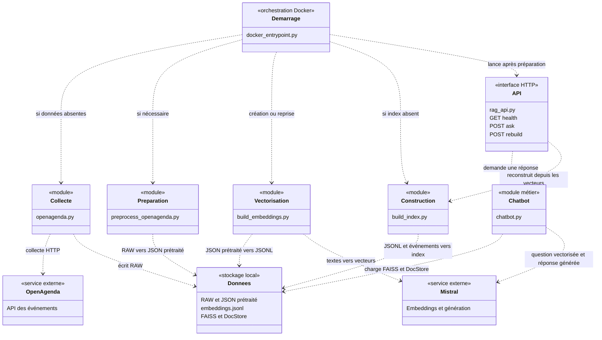
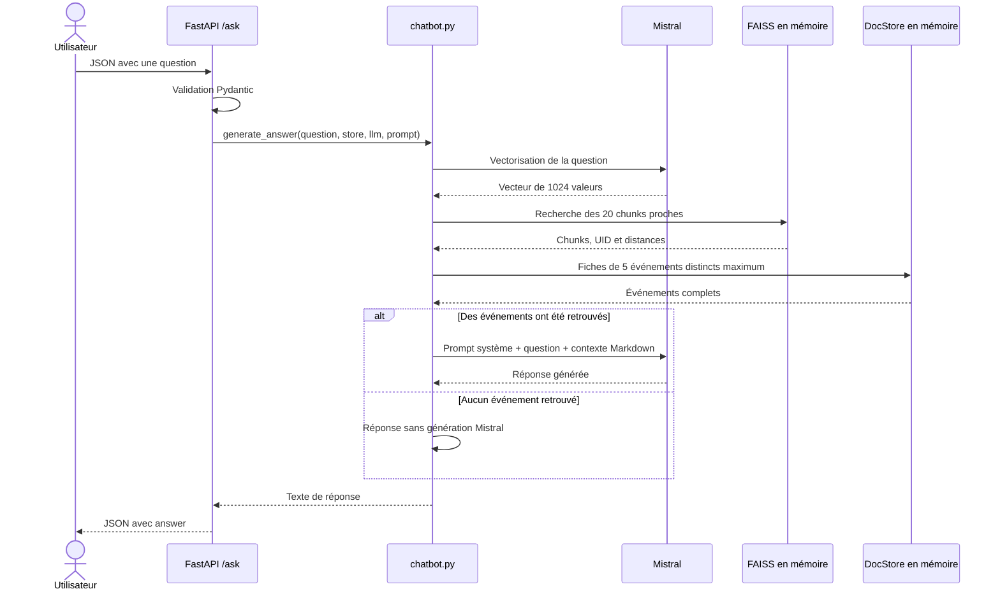

# Rapport technique — RAG OpenAgenda Toulouse

Ce rapport présente l'architecture et les choix du projet OpenClassrooms IA Engineer RNCP7. Il décrit le code actuel ; il ne constitue pas une preuve d'exécution ou de performance. Les commandes d'installation et d'utilisation sont dans le [README](../README.md).

## 1. Objectif et périmètre

Le système répond en français à des questions sur les événements de Toulouse. Il collecte les données OpenAgenda, prépare une base documentaire locale et transmet à Mistral les événements retrouvés pour générer une réponse.

Deux interfaces utilisent la même logique métier : le terminal et l'API FastAPI. Docker orchestre la préparation et le démarrage de l'API. Les tests techniques et l'évaluation Ragas constituent deux moyens de validation distincts.

## 2. Vue UML de l'architecture

Ce diagramme UML représente les modules et leurs dépendances, avec la notation de classes de Mermaid et des stéréotypes. Les blocs sont des **composants logiques**, pas des classes Python à créer. Une flèche en pointillés signifie « utilise ou dépend de » ; les libellés précisent les échanges.



Le prompt `App/RAG/prompt_system_chatbot.md` est lu par le chatbot. L'utilisateur accède à l'API depuis Swagger ou un client HTTP ; il peut aussi lancer le terminal de `chatbot.py`. Les tests et Ragas sont exécutés séparément et ne sont pas nécessaires au traitement d'une question.

## 3. Rôle des composants et contrats de données

| Composant | Entrée | Traitement et sortie |
|---|---|---|
| `App/API/openagenda.py` | API OpenAgenda et clé de collecte | Pagination des agendas et événements ; écrit un export RAW horodaté avec le schéma de référence. |
| `App/Preprocessing/preprocess_openagenda.py` | Dernier RAW | Dédoublonne par UID, extrait les informations et décode les catégories ; écrit un nouveau JSON prétraité sans modifier le RAW. |
| `App/RAG/build_embeddings.py` | Dernier JSON prétraité | Valide les événements, crée les chunks, appelle Mistral par lots et sauvegarde progressivement les vecteurs. |
| `App/RAG/build_index.py` | JSONL d'embeddings et JSON prétraité | Construit FAISS depuis les vecteurs existants et ajoute les fiches complètes au DocStore ; aucun appel Mistral. |
| `App/RAG/chatbot.py` | Question, ressources chargées et prompt | Recherche les chunks, retrouve les événements, prépare le contexte et génère la réponse ; propose aussi une boucle terminal. |
| `App/API/rag_api.py` | Requêtes HTTP | Valide les entrées, réutilise les ressources RAG, traduit les erreurs et protège `/rebuild` par token. |
| `prompt_system_chatbot.md` | Instructions système | Encadre la génération ; son contenu est distinct du contexte documentaire et de la question. |
| `docker_entrypoint.py` | Configuration et état des données internes | Exécute les étapes manquantes et remplace son processus par Uvicorn ; bloque le démarrage en cas d'échec. |
| `tests/` | Données de test et services simulés | Vérifie le comportement technique sans appels réels aux services ; `run_tests.py` produit le résumé et la couverture. |
| `App/Evaluation/evaluate_rag.py` | Jeu annoté `question.json` et RAG prêt | Exécute les questions et les mesures de qualité ; écrit un rapport JSON horodaté avec erreurs et scores distincts. |
| `App/Evaluation/generate_report.py` | Rapports d'évaluation | Génère un tableau de bord HTML local sans nouvel appel API. |

### Stockage sous `App/Data/`

```text
raw/ → processed/ → embeddings/embeddings.jsonl → vector_store/
                                                ├── Vector_Store.faiss
                                                └── DocStore_LangChain.pkl

evaluation/                 Rapports Ragas et dashboard.html
resultats_tests_unitaires/  Résumé HTML, logs, XML et couverture
```

Le JSONL contient **un lot par ligne**, avec, pour chaque chunk, `page_content`, `metadata` et `vector`. Le texte est envoyé au modèle d'embedding ; les métadonnées servent à identifier le chunk et son événement. Elles comprennent `uid`, `chunk_id`, `chunk_index`, `section` et les liens entre fragments lorsque la section est divisée.

FAISS stocke les vecteurs. Le DocStore conserve les documents et la correspondance entre les positions de l'index et leurs identifiants. Il contient également une fiche complète par événement, identifiée par `event_<uid>`. La recherche d'un chunk permet donc de remonter à l'événement complet sans dupliquer ses informations dans tous les chunks.

## 4. Parcours UML d'une question



Les ressources sont chargées au démarrage de l'API, puis réutilisées. Chaque question déclenche sa propre recherche, sans historique conversationnel. Les embeddings des événements ne sont pas recalculés pendant les questions.

## 5. Choix techniques et justification

| Choix | Intérêt pour ce projet | Compromis ou limite |
|---|---|---|
| Quatre sections thématiques | Regrouper des informations cohérentes pour retrouver un passage ciblé. | Un événement produit plusieurs chunks. |
| Maximum de 2 048 caractères, en-tête compris | Borner la taille de chaque document ; découpage naturel avec chevauchement visé de 150 caractères. | Ce sont des caractères, pas des tokens ; le chevauchement réel peut être inférieur. |
| `mistral-embed`, dimension 1 024 | Utiliser le même espace vectoriel pour les événements et les questions. | Dépendance à l'API, aux quotas et au modèle choisi. |
| Lots de 32 et JSONL progressif | Limiter le travail à reprendre après interruption. | Un lot calculé mais non sauvegardé peut devoir être recalculé. |
| FAISS via LangChain | Recherche locale et association entre vecteurs et documents, sans serveur de base de données. | L'index est chargé en mémoire ; la taille du jeu reste à maîtriser. |
| Fiches complètes dans le DocStore | Conserver horaires, liens et informations utiles à la génération. | Le contexte envoyé à Mistral peut être volumineux. |
| FastAPI et Pydantic | Contrats HTTP explicites, validation et documentation Swagger. | L'API actuelle ne gère pas les usages concurrents du TP. |
| Docker et un script de démarrage | Reproduire l'environnement et préparer les données sans fichiers Windows montés. | Le premier lancement dépend d'Internet ; l'image contient toutes les dépendances du projet. |

La reprise des embeddings compare nombre, ordre, textes et métadonnées aux chunks actuels ; chaque vecteur doit contenir 1 024 valeurs finies. Les lots valides sont conservés, une dernière ligne tronquée peut être réparée, et une autre incohérence bloque la reprise. `flush()` et `os.fsync()` sécurisent les écritures sauvegardées.

## 6. Démarrage, reconstruction et cycle de vie

Au premier démarrage Docker, les étapes s'enchaînent : collecte, prétraitement, embeddings, construction FAISS et démarrage de l'API. Lors d'une reprise, les fichiers intermédiaires sont réutilisés. Un index déjà présent évite la collecte et la vectorisation ; FastAPI vérifie son chargement avant d'accepter les requêtes en mode Docker.

Les fichiers sont créés dans le conteneur sous `/app/App/Data/`, avec un utilisateur non privilégié. Un arrêt conserve les données du même conteneur ; sa suppression les efface. Un nouveau conteneur peut donc entraîner de nouveaux appels et coûts Mistral.

`POST /rebuild` ne relance ni collecte ni embeddings. La route construit un index séparé, remplace l'ancien puis recharge les ressources. Si ce rechargement échoue, le mécanisme restaure l'ancien index. Une sauvegarde laissée par une interruption doit être examinée avant une nouvelle opération. L'actualisation des événements OpenAgenda n'est pas automatique.

## 7. Validation, sécurité et limites

| Dispositif | Ce qu'il permet de vérifier |
|---|---|
| Tests techniques | Collecte, prétraitement, chunks, sauvegarde/reprise, FAISS, génération simulée et routes HTTP. |
| Couverture | Lignes exécutées de `App/API`, `App/Preprocessing` et `App/RAG` ; ni qualité des réponses ni couverture de l'orchestrateur Docker. |
| Recall@5 | Proportion des UID attendus retrouvés parmi les événements retenus. |
| Ragas sur Q01 à Q10 | Faithfulness, Answer Relevancy et Factual Correctness F1. |
| Examen humain de Q11/Q12 | Analyse des réponses aux questions de sécurité, conservées séparément. |

Les rapports distinguent les scores faibles, les métriques non calculées et les erreurs techniques. Les moyennes indiquent leur effectif. Aucun résultat chiffré n'est affirmé ici : les rapports issus des exécutions doivent servir de preuve lors de la soutenance.

Les clés `OPENAGENDA_API_KEY`, `MISTRAL_API_KEY` et le token `RAG_ADMIN_TOKEN` sont fournis par configuration, jamais intégrés à l'image. `/rebuild` est protégé par authentification Bearer ; `/ask` ne l'est pas et doit rester accessible localement dans cette configuration. Les erreurs HTTP ne transmettent pas les détails bruts des services externes.

Le DocStore pickle doit provenir de l'application : sa lecture peut exécuter du code. Les contextes documentaires sont envoyés à Mistral ; l'application n'est donc pas autonome vis-à-vis des services externes.

Enfin, un seul worker et des appels successifs sont prévus, sans verrou. La recherche sémantique ne garantit pas un filtre strict sur les dates ou l'âge du public. Le jeu de douze questions est limité et les jugements automatiques demandent une lecture critique. La validation complète du démarrage Docker doit être effectuée séparément, avec autorisation des appels API.
